# Arquitetura — Modelo C4 (Mermaid)

**Autor:** Paulo Henrique de Lima

Níveis: 1 Contexto · 2 Contêineres · 3 Componentes (Processo 1 e Processo 2) · 4 Código · Dinâmico · Estados · Implantação.
Renderiza no GitHub/GitLab, VS Code (extensão Mermaid) e mermaid.live.

## Nível 1 — Contexto

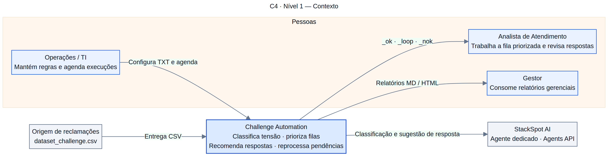
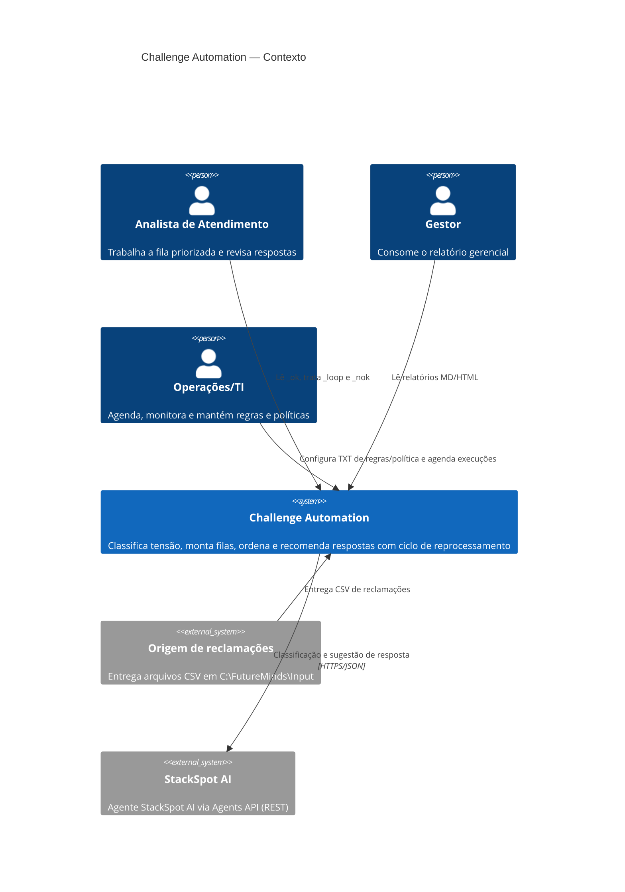

## Nível 2 — Contêineres

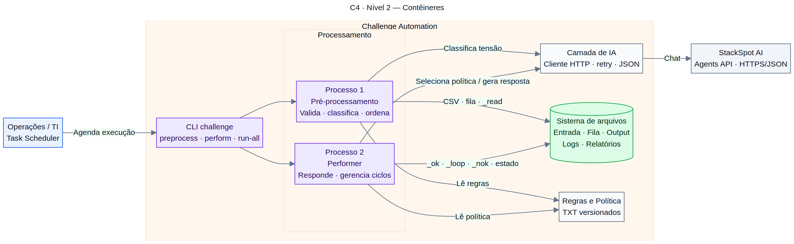
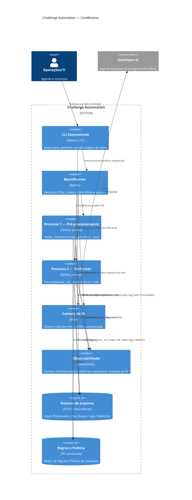

## Nível 3 — Componentes do Processo 1

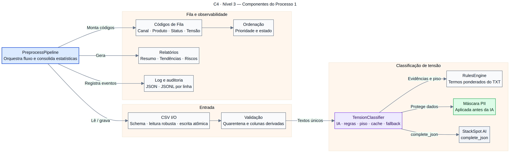
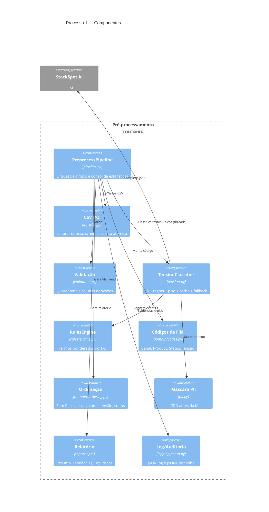

## Nível 3 — Componentes do Processo 2

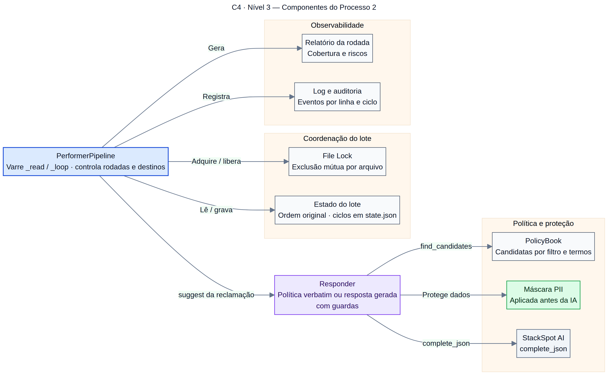
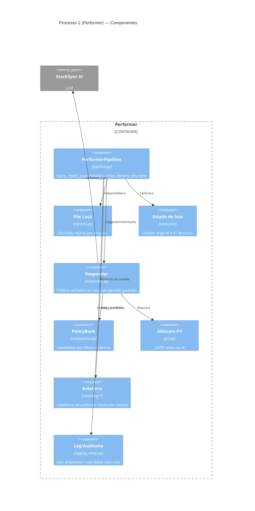

## Nível 4 — Código

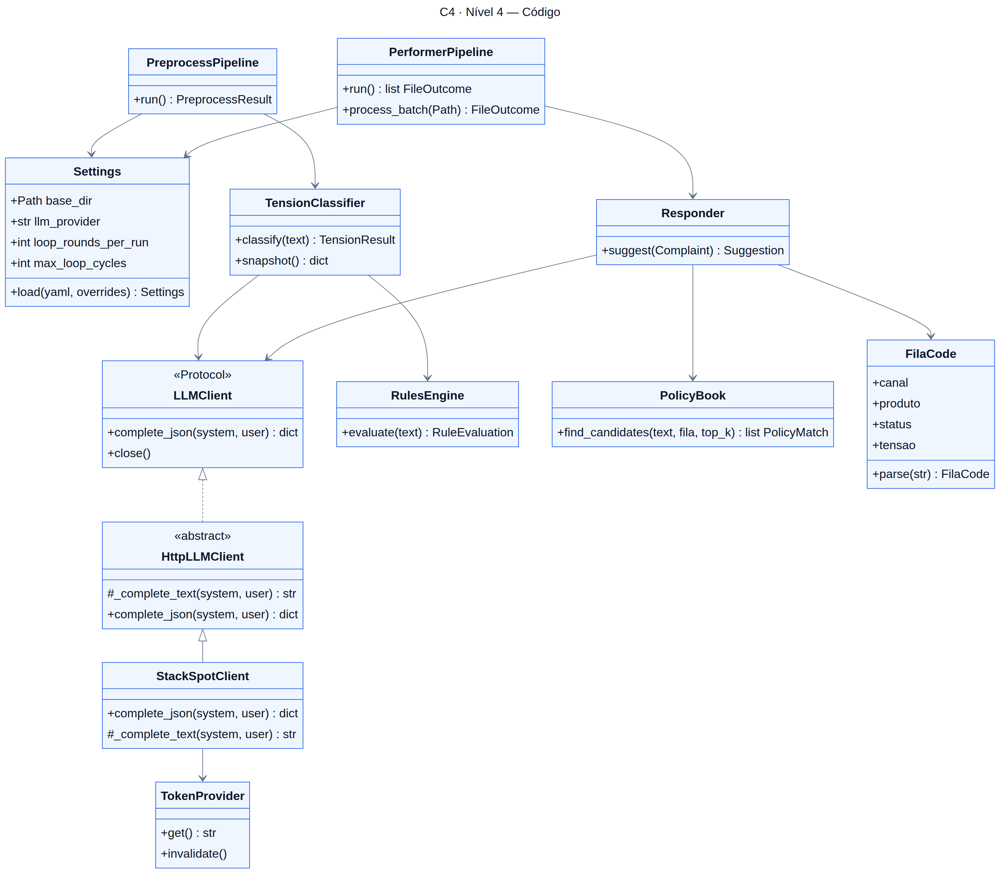
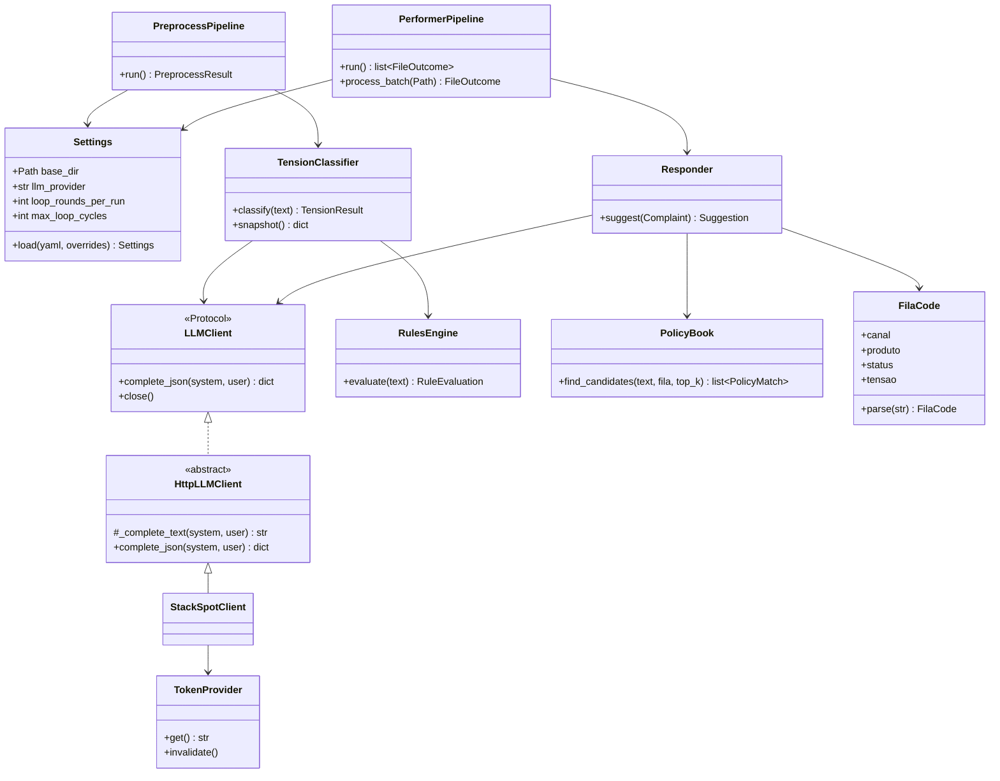

## Dinâmico — fluxo ponta a ponta com ciclo `_loop`


```mermaid
sequenceDiagram
  autonumber
  participant Sch as Task Scheduler
  participant P1 as Processo 1
  participant FS as Arquivos
  participant LLM as StackSpot AI
  participant P2 as Performer
  Sch->>P1: futureminds run-all
  loop CSVs ordenados em Input
    P1->>FS: descobre arquivo arbitrário *.csv
    P1->>FS: lê e valida; rejeitadas em Fila
  loop textos únicos
    P1->>LLM: tensão (texto mascarado + termos)
    LLM-->>P1: Alta/Média/Baixa
  end
    P1->>FS: gera Fila, _read, relatório, auditoria e estatísticas
    Sch->>P2: Performer do arquivo atual
    P2->>FS: processa _read; gera _ok/_loop/_nok e seus logs
    P1->>FS: move origem para Processados após logs
  end
  Sch->>P2: futureminds perform (pendências existentes)
  P2->>FS: varre _read e _loop
  loop rodadas (até loop_rounds_per_run)
    loop linhas pendentes
      P2->>LLM: política ou resposta
      LLM-->>P2: JSON ou falha
    end
    P2->>FS: respondidas acrescentadas a _ok (ordem original)
    P2->>FS: pendentes gravadas em _loop
  end
  alt sem pendentes
    P2->>FS: remove _loop e state (lote concluído)
  else ciclos esgotados
    P2->>FS: pendentes em _nok
  else restam pendentes
    P2->>FS: mantém _loop para a próxima execução
  end
```

## Estados do lote

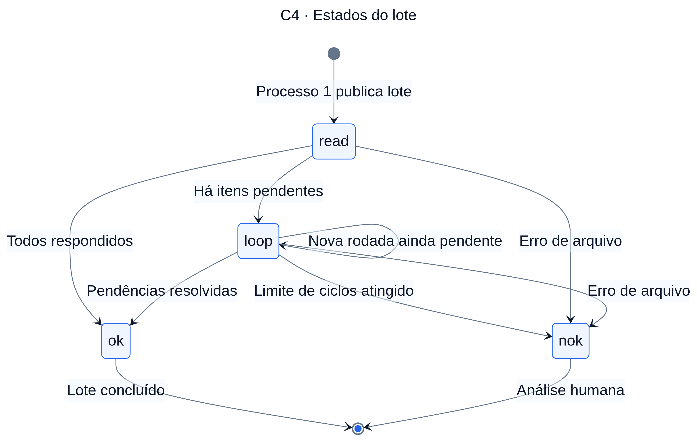
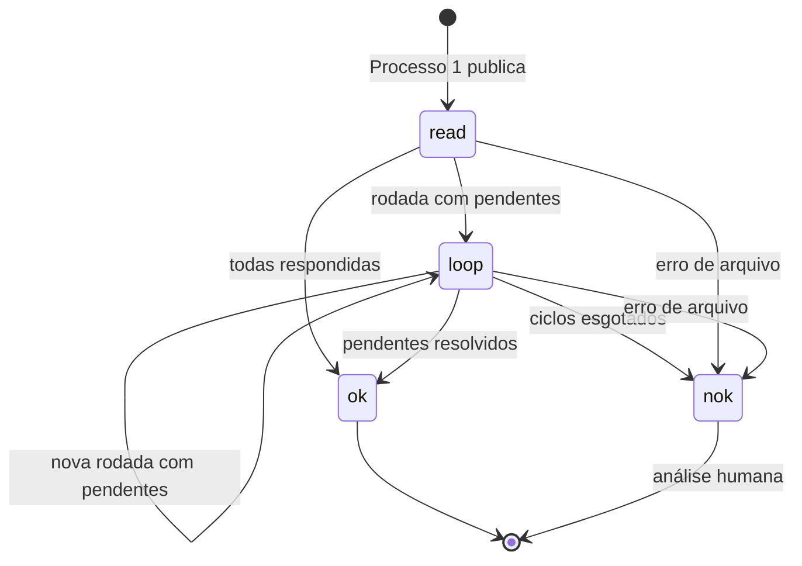

## Implantação

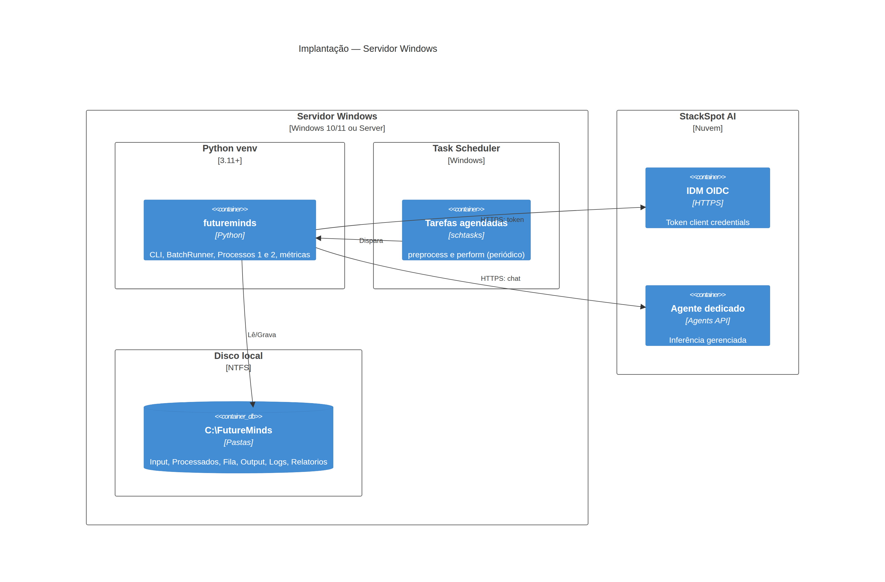
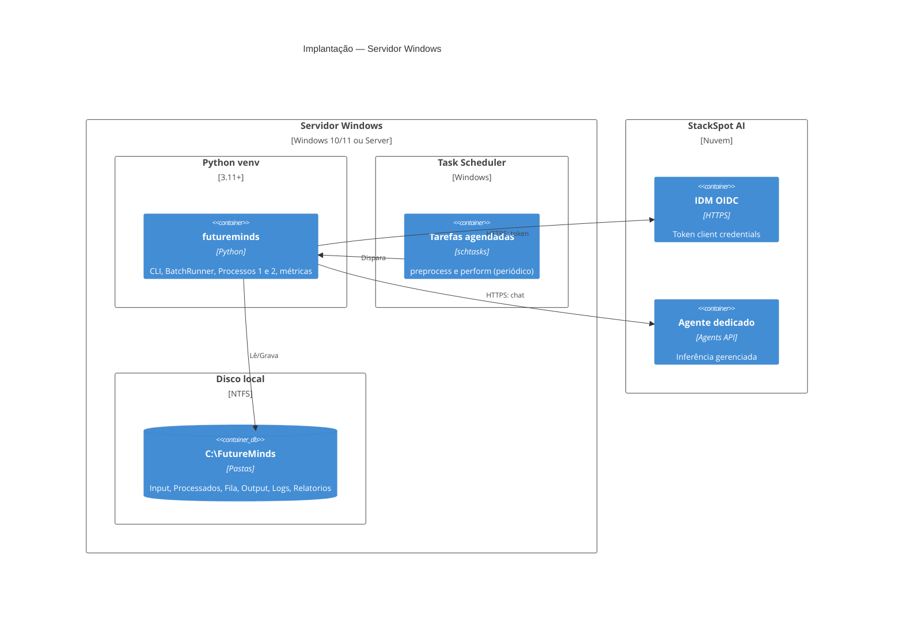
